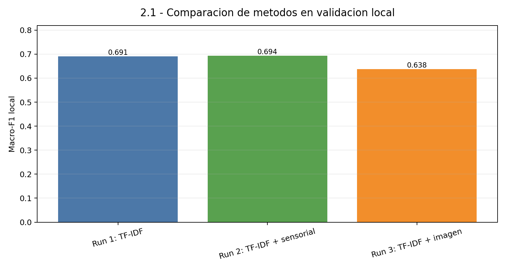
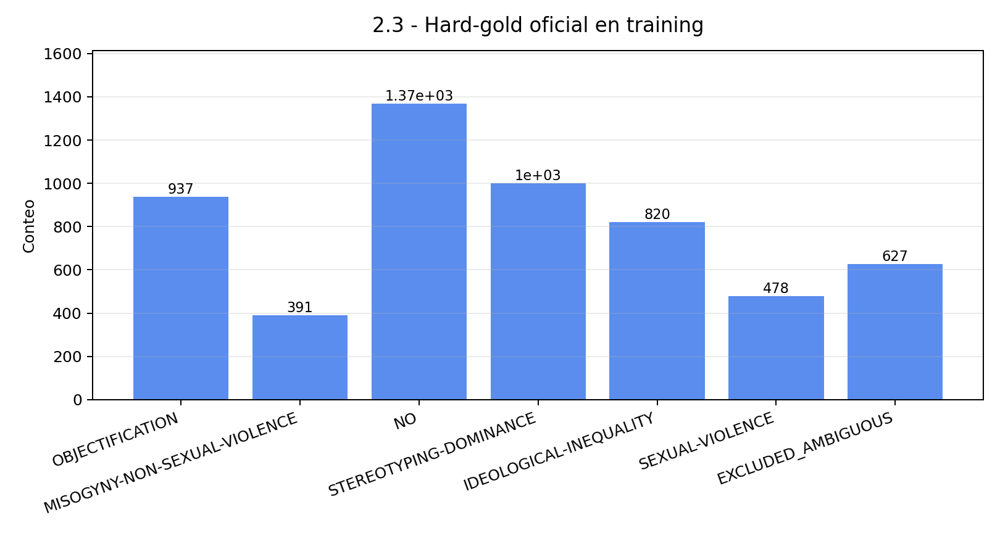

# EXIST 2026: Detección de sexismo en memes

[](https://www.python.org/)
[](https://scikit-learn.org/)
[](https://platform.openai.com/)
[](https://nlp.uned.es/exist2026/)

Participación del equipo **Os-Faixa-Preta-do-Data** en la **Tarea 2 (memes)** de [EXIST 2026](https://nlp.uned.es/exist2026/), el *shared task* de CLEF sobre identificación de sexismo en redes sociales. El sistema clasifica memes en español e inglés combinando el texto extraído por OCR, **descripciones generadas por un modelo de visión y lenguaje (VLM)** y **señales fisiológicas** de los espectadores (eye tracking, ritmo cardíaco y EEG).

Proyecto de la asignatura de **Lenguaje Natural y Recuperación (LNR)** del Grado en Ciencia de Datos de la Universitat Politècnica de València (mayo de 2026).

---

## Nota sobre el código fuente

Este repositorio **no contiene el código fuente**: el código está en el repositorio del equipo. Aquí se documentan el problema, la arquitectura, los experimentos y los resultados.

📄 **Informe final completo:** [`docs/FINAL_REPORT.pdf`](docs/FINAL_REPORT.pdf)

---

## El problema

| Subtarea | Pregunta | Tipo | Clases |
|---|---|---|---|
| **2.1** | ¿El meme es sexista? | Binaria | `YES`, `NO` |
| **2.2** | ¿Cuál es la intención del autor? | Jerárquica, una etiqueta | `NO`, `DIRECT`, `JUDGEMENTAL` |
| **2.3** | ¿Qué tipo de sexismo contiene? | Jerárquica, multietiqueta | `NO` + 5 categorías (objetivación, estereotipos, violencia sexual, desigualdad ideológica…) |

- **Datos:** 3.984 memes de entrenamiento y 1.053 de test, equilibrados entre español e inglés.
- **Etiquetado con desacuerdo:** cada meme lo anotan varias personas, así que se entregan predicciones *hard* (una etiqueta) y *soft* (distribución de probabilidad).
- **Métrica oficial:** ICM / ICM-soft, pensada para jerarquías y desacuerdo entre anotadores.
- **Límite:** 3 envíos *hard* + 3 *soft* por subtarea.

---

## Arquitectura

```text
            ┌── Texto OCR ─────────────────────────────┐
            │                                          │
  Meme ─────┼── Imagen ──► VLM (gpt-4o-mini) ──► Descripción visual
            │                                  └► Análisis de sexismo
            │                                          │
            └── Señales fisiológicas (ET · HR · EEG) ──┤
                                                       ▼
                                  TF-IDF (n-gramas de palabra + carácter)
                                                       ▼
                                  Regresión logística / One-vs-Rest
                                                       ▼
                                  Predicciones hard + soft (formato EXIST)
```

### 1. Enriquecimiento con VLM
- La imagen de cada meme se pasa a **gpt-4o-mini**, que genera una **descripción visual** y un **análisis explícito de sexismo**.
- El VLM **no clasifica**: convierte la imagen en texto, que después procesa el mismo clasificador. Así la comparación es limpia y se mide cuánto aporta la información visual.
- Las respuestas se guardan en caché para que los experimentos sean reproducibles sin volver a llamar a la API.

### 2. Representación
- **Preprocesado:** normalización Unicode NFKC, minúsculas y limpieza de URLs y menciones. Las *stopwords* se mantienen a propósito, porque los pronombres con género aportan señal.
- **TF-IDF** que concatena n-gramas de **palabra** (léxico) y de **carácter** (robustez frente al ruido del OCR y al bilingüismo).
- **Señales fisiológicas:** resúmenes de eye tracking (fijaciones, sacadas, pupila, parpadeos), ritmo cardíaco y potencia por bandas de EEG. Los huecos se rellenan con la mediana, los valores extremos se recortan y todo se estandariza solo con estadísticas del conjunto de entrenamiento, añadiendo máscaras de presencia.
- **Descriptores de imagen de bajo nivel** (color, histogramas, bordes), probados como ablación.

### 3. Clasificación
- **2.1 y 2.2:** regresión logística con pesos equilibrados por clase.
- **2.3:** regresión logística One-vs-Rest, con un umbral por etiqueta. Si ninguna categoría lo supera, la predicción es `NO`.
- Un clasificador **deliberadamente sencillo y fácil de inspeccionar**: la mejora viene de la representación, no de un modelo opaco.

---

## Sistemas enviados

| Run | Sistema | Entrada |
|:---:|---|---|
| 1 | **VLM completo** | OCR + descripción VLM + análisis de sexismo VLM |
| 2 | VLM solo descripción | OCR + descripción VLM (ablación) |
| 3 | Respaldo sin VLM | 2.1: OCR + fisiológicas · 2.2 y 2.3: solo OCR |

Los tres envíos funcionan como una **ablación controlada**, no como sistemas independientes: cada uno aísla la aportación de una fuente de información.

---

## Resultados

Macro-F1 con **validación cruzada de 5 particiones** (mismas particiones para todas las variantes, semilla 42):

| Subtarea | Mejor sin VLM | VLM descripción | **VLM completo** | Mejora |
|---|---:|---:|---:|---:|
| 2.1 | 0.6556 | 0.6809 | **0.7179** | +0.062 |
| 2.2 | 0.4531 | 0.4811 | **0.5164** | +0.063 |
| 2.3 (5 clases) | 0.3645 | 0.4069 | **0.4584** | +0.094 |
| 2.3 (6 clases) | 0.4215 | 0.4581 | **0.5043** | +0.083 |

### ¿Ayudan las señales fisiológicas?

| Subtarea | Solo OCR | OCR + fisiológicas | Diferencia |
|---|---:|---:|---:|
| 2.1 | 0.6430 | 0.6556 | **+0.013** |
| 2.2 | 0.4429 | 0.4531 | **+0.010** |
| 2.3 (5 clases) | 0.3645 | 0.3573 | −0.007 |
| 2.3 (6 clases) | 0.4215 | 0.4154 | −0.006 |

<p align="center">
  
  
</p>

---

## Conclusiones

1. **El texto OCR ya es una base sólida.** Muchos memes contienen pistas explícitas, y los n-gramas de carácter absorben bien el ruido del OCR y la mezcla de idiomas.
2. **Las señales fisiológicas ayudan, pero depende de la tarea.** Mejoran algo la detección binaria y la de intención, porque la atención y la activación se relacionan con si un meme *se percibe* como sexista. No ayudan a distinguir *qué tipo* de sexismo hay, que requiere entender el significado.
3. **La mayor mejora viene de convertir la imagen en texto con un VLM.** Los descriptores visuales de bajo nivel no captan el significado. Una descripción del VLM sí, y el análisis explícito de sexismo añade otra mejora clara, sobre todo en la categorización fina (+9 puntos en 2.3).

## Limitaciones y trabajo futuro
- Las etiquetas de test no son públicas, así que la selección de modelos se hizo con macro-F1 como aproximación a ICM.
- Los resultados dependen de la calidad de las descripciones que genera el VLM.
- Se exploró el *fine-tuning* de XLM-RoBERTa, pero no se incluyó en el envío final por reproducibilidad.

---

## Stack

`Python` · `scikit-learn` · `pandas` · `NumPy` · `OpenAI API (gpt-4o-mini, visión)` · `asyncio` · `LaTeX`

## Equipo

**Os-Faixa-Preta-do-Data**: Nouh Khouyi e Imad Rifai. El reto se desarrolló entero en pareja: pipeline de datos, extracción de características, generación con el VLM, experimentos, envíos e informe final.
